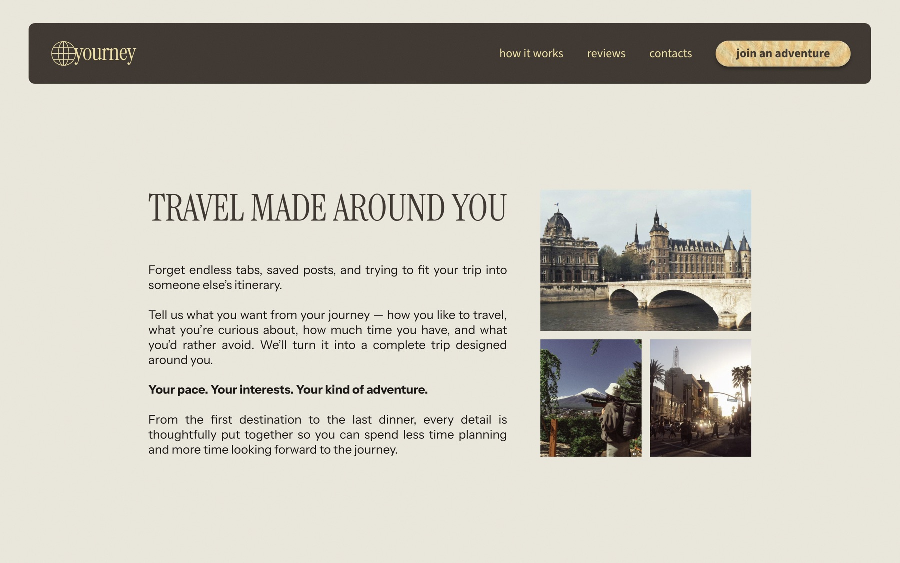
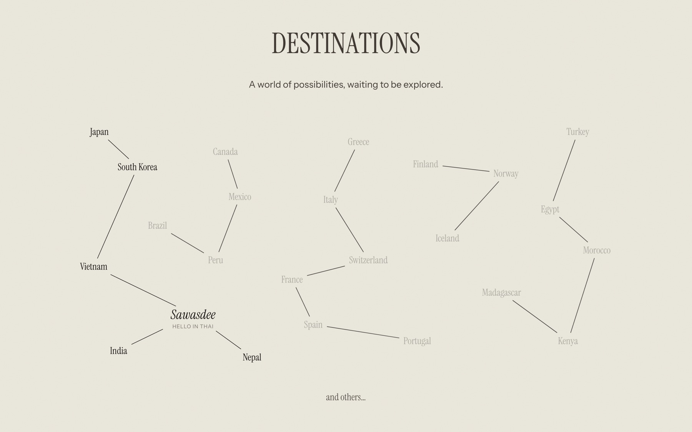
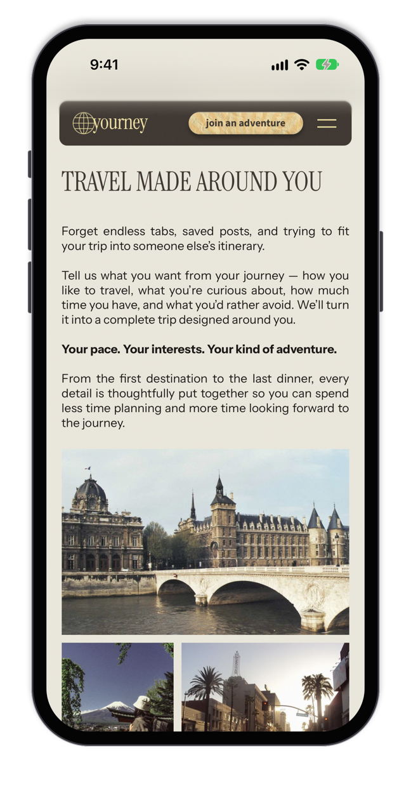
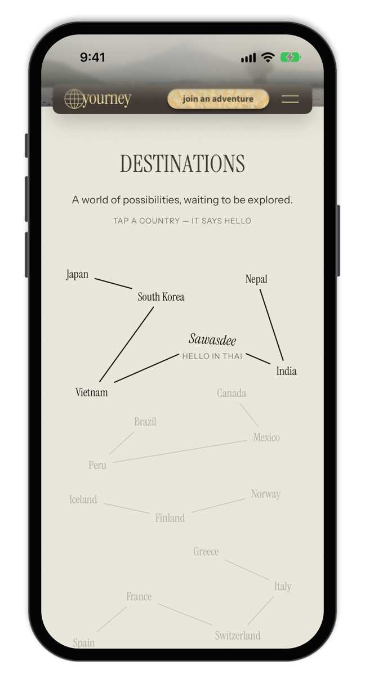
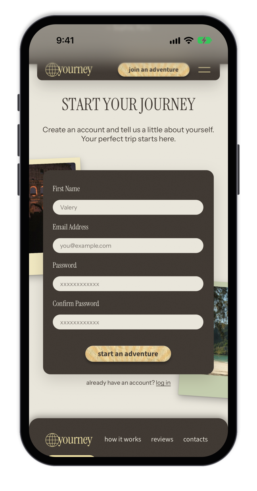

# ✦ Yourney

A landing page for Yourney, a travel service that turns your answers into a trip designed around you. ⋆｡°✩

**⊹ Open it:** [Yourney](https://vvallll.github.io/yourney/)

### ⊹ About the project

The service itself is **imaginary**: I designed the page in Figma first, then turned the design into a real website.

### ⊹ Features

- ✦ The first screen fits the window, with the text and a photo collage side by side.
- ✦ Destinations as five constellations, one per region: hover or tap a country and it says hello in its own language.
- ✦ Section titles twitch, photos straighten up, and the sun rays on the paper buttons sway. On phones and tablets a tap does what the hover does.
- ✦ The log in form unfolds into sign up with a Confirm Password field.
- ✦ Fluid from phones to wide screens: every size grows smoothly, with tablet and phone layouts of their own.

### ✧ Screens

Destinations, with Thailand saying hello and its constellation lit up:

On a phone: the first screen, the destinations map and the sign up form:

  
  &nbsp;
  
  &nbsp;
  

### ⊹ How it's built

Plain HTML, CSS and a bit of vanilla JavaScript, with no build step and no dependencies; the fonts are stored in the project.

- ✦ `index.html` · the page
- ✦ `css/style.css` · palette, fluid type scale, sections and the tablet and phone layouts
- ✦ `js/main.js` · animations, taps on touch screens, the destinations map and the form
- ✦ `images/` · photos, the paper button texture and the tab icon
- ✦ `fonts/` · Instrument Serif, Instrument Sans and Source Sans 3
- ✦ `screenshots/` · the pictures in this README

### ୨୧ Design

`#3C352F` · `#EBE8DD` · `#F0E2A4` · `#C5CEAE`

`Instrument Serif` · `Instrument Sans` · `Source Sans 3`

### ♡ A trip around you

`Figma → HTML → CSS → a little animation → a trip made around you` ⊹
